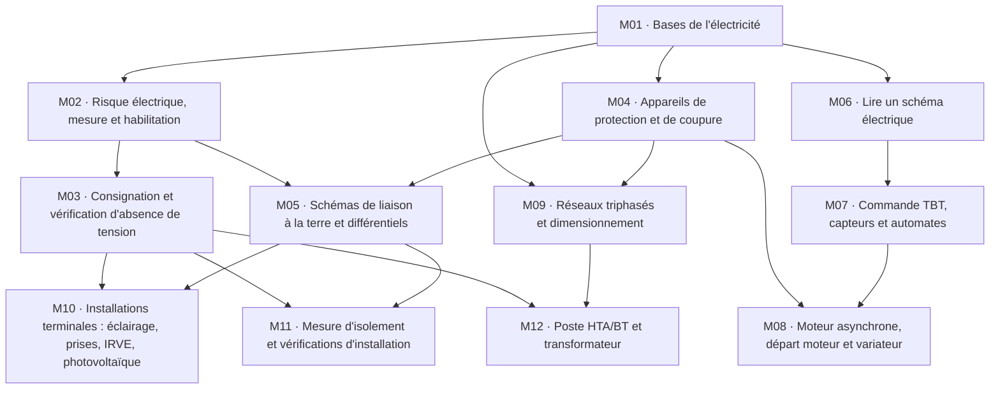

# Proposition de modules · à valider

> **Statut : proposition (phase 2).** Aucun code n'est modifié. Ce document attend ton accord (et celui de ton formateur)
> avant la phase 3. Rien n'est supprimé : chaque élément existant est rattaché à un module, et à un seul.

## Ce que ce document contient, et ce qu'il ne contient pas

- **12 modules**, chacun avec 2 à 4 objectifs rédigés en « Je sais… », ses prérequis, la liste de tous les
  éléments qui lui sont rattachés (par identifiant), les comptes par mode et ses trous de couverture.
- Le **graphe des prérequis** et l'ordre de première découverte qui en découle.
- Le **tableau de couverture** module × mode, avec les seuils prévus pour la phase 4.
- Les **éléments non rattachés** et les **rattachements discutables**.
- Les **décisions à prendre** avant la phase 3.

Ce qu'il ne contient pas :

- **Aucun intitulé de compétence du référentiel du BTS MS.** Chaque module aura un champ `competenceReferentiel` vide,
  à remplir avec ton formateur.
- **Aucun nouveau contenu technique.** Les objectifs « Je sais… » décrivent ce que le contenu existant entraîne déjà ;
  ils sont à relire avec ton formateur (formulation, découpage, niveau d'exigence).

Le rattachement a été vérifié par un script : 70 questions de reconnaissance, 37 types de calcul,
30 cas de panne, 14 pannes de banc, 8 mesures d'isolement et 26 fiches mémo,
soit 185 éléments, chacun rattaché une fois, sans identifiant inconnu, et sans cycle dans les prérequis.

## 1. Vue d'ensemble

| Module | Titre | Prérequis | Reco. | Calculs | Cas | Banc | Isolement | Fiches | Niveaux |
|---|---|---|---:|---:|---:|---:|---:|---:|---|
| M01 | Bases de l'électricité | — | 7 | 4 | 0 | 0 | 0 | 2 | I |
| M02 | Risque électrique, mesure et habilitation | M01 | 7 | 1 | 0 | 0 | 0 | 3 | I, II, III |
| M03 | Consignation et vérification d'absence de tension | M02 | 3 | 0 | 3 | 0 | 0 | 1 | I, II, III |
| M04 | Appareils de protection et de coupure | M01 | 5 | 2 | 2 | 0 | 0 | 2 | I, II, III |
| M05 | Schémas de liaison à la terre et différentiels | M02, M04 | 3 | 2 | 4 | 0 | 0 | 2 | I, II, III |
| M06 | Lire un schéma électrique | M01 | 12 | 0 | 0 | 1 | 0 | 2 | I, II, III |
| M07 | Commande TBT, capteurs et automates | M06 | 9 | 4 | 5 | 3 | 0 | 3 | I, II, III |
| M08 | Moteur asynchrone, départ moteur et variateur | M04, M07 | 12 | 5 | 5 | 5 | 0 | 3 | I, II, III |
| M09 | Réseaux triphasés et dimensionnement | M01, M04 | 0 | 11 | 1 | 0 | 0 | 2 | I, II, III |
| M10 | Installations terminales : éclairage, prises, IRVE, photovoltaïque | M03, M05 | 6 | 0 | 2 | 5 | 0 | 2 | I, II, III |
| M11 | Mesure d'isolement et vérifications d'installation | M03, M05 | 1 | 4 | 4 | 0 | 8 | 2 | I, II, III |
| M12 | Poste HTA/BT et transformateur | M03, M09 | 5 | 4 | 4 | 0 | 0 | 2 | I, II, III |
| | **Total** | | **70** | **37** | **30** | **14** | **8** | **26** | |

Les niveaux I, II et III existants deviennent une **difficulté à l'intérieur de chaque module** : la première découverte
d'un module va du niveau I au niveau III.

## 2. Graphe des prérequis

En texte (« A → B » : A est un prérequis de B) :

- M01 → **M02** Risque électrique, mesure et habilitation
- M02 → **M03** Consignation et vérification d'absence de tension
- M01 → **M04** Appareils de protection et de coupure
- M02 + M04 → **M05** Schémas de liaison à la terre et différentiels
- M01 → **M06** Lire un schéma électrique
- M06 → **M07** Commande TBT, capteurs et automates
- M04 + M07 → **M08** Moteur asynchrone, départ moteur et variateur
- M01 + M04 → **M09** Réseaux triphasés et dimensionnement
- M03 + M05 → **M10** Installations terminales : éclairage, prises, IRVE, photovoltaïque
- M03 + M05 → **M11** Mesure d'isolement et vérifications d'installation
- M03 + M09 → **M12** Poste HTA/BT et transformateur

**Ordre de première découverte** (tri topologique) : M01 → M02 → M03 → M04 → M05 → M06 → M07 → M08 → M09 → M10 → M11 → M12.

Trois chemins partent des bases : la **sécurité** (M02 → M03), la **protection et les réseaux** (M04 → M05, M09) et
le **schéma et la commande** (M06 → M07). Ils se croisent ensuite : M05 demande la sécurité et la protection, M08 la
protection et la commande, M10 et M11 la consignation et les différentiels, M12 la consignation et les réseaux.
La révision, elle, mélange les modules déjà ouverts (pratique entrelacée, phase 3).

## 3. Les modules en détail

### M01 · Bases de l'électricité

- **Prérequis** : aucun (porte d'entrée ; le socle des 4 piliers y prépare)
- **competenceReferentiel** : _(vide, à remplir avec le formateur)_
- **Objectifs** (à relire) :
  - Je sais distinguer tension, courant et résistance, et dire ce que mesure un multimètre.
  - Je sais appliquer la loi d'Ohm et calculer une puissance et une énergie.
  - Je sais reconnaître phase, neutre et conducteur de protection par leur rôle et leur couleur.

**Reconnaissance (7)** : `reco-decouverte-tension` (I), `reco-decouverte-courant` (I), `reco-decouverte-phase` (I), `reco-decouverte-terre` (I), `reco-decouverte-multimetre` (I), `reco-couleur-neutre` (I), `sym-terre-protection` (I)

**Calculs (4)** : `ohm` (I), `puissance` (I), `tension-attendue` (I), `kilovolts` (I)

**Fiches mémo (2)** : `bases-electricite`, `loi-ohm-puissance`

**Trous** : 7 questions de reconnaissance sur 8 attendues (il en manque 1) ; aucun cas de panne ni panne de banc : le critère « au moins un cas ou une panne réussi » est impossible à remplir ; rien au niveau II ; rien au niveau III.

### M02 · Risque électrique, mesure et habilitation

- **Prérequis** : M01 (Bases de l'électricité)
- **competenceReferentiel** : _(vide, à remplir avec le formateur)_
- **Objectifs** (à relire) :
  - Je sais expliquer les effets du courant sur le corps humain et le rôle du seuil de 30 mA.
  - Je sais choisir un appareil de mesure ou un VAT adapté à la catégorie de mesure du lieu.
  - Je sais situer une installation dans son domaine de tension et dire ce qu'une habilitation autorise ou non.

**Reconnaissance (7)** : `reco-vat-appareil` (I), `reco-cat-marquage` (II), `reco-cat-tgbt` (II), `reco-cat-fusibles` (III), `reco-epi-vat` (II), `reco-domaine-hta` (I), `reco-habilitation-b1v` (II)

**Calculs (1)** : `courant-corps` (I)

**Fiches mémo (3)** : `vat-cat`, `domaines-tension`, `effets-courant`

**Trous** : 7 questions de reconnaissance sur 8 attendues (il en manque 1) ; aucun cas de panne ni panne de banc : le critère « au moins un cas ou une panne réussi » est impossible à remplir.

### M03 · Consignation et vérification d'absence de tension

- **Prérequis** : M02 (Risque électrique, mesure et habilitation)
- **competenceReferentiel** : _(vide, à remplir avec le formateur)_
- **Objectifs** (à relire) :
  - Je sais dérouler une consignation dans l'ordre, de la séparation à la vérification d'absence de tension.
  - Je sais condamner et signaler un appareil de séparation.
  - Je sais reconnaître une situation où la consignation ne suffit pas (double alimentation, appareil sans pouvoir de coupure).

**Reconnaissance (3)** : `reco-cadenas-pancarte` (I), `sym-sectionneur` (II), `reco-sectionneur-charge` (III)

**Cas de panne (3)** : `consignation-contacteur` (I), `vat-procedure` (I), `double-source` (II)

**Fiches mémo (1)** : `consignation`

**Trous** : 3 questions de reconnaissance sur 8 attendues (il en manque 5) ; aucun calcul.

### M04 · Appareils de protection et de coupure

- **Prérequis** : M01 (Bases de l'électricité)
- **competenceReferentiel** : _(vide, à remplir avec le formateur)_
- **Objectifs** (à relire) :
  - Je sais distinguer fusible, disjoncteur, interrupteur et sectionneur par leur fonction.
  - Je sais lire le calibre et la courbe d'un disjoncteur et en déduire son seuil de déclenchement.
  - Je sais expliquer pourquoi un défaut ne doit couper que le départ concerné (sélectivité).

**Reconnaissance (5)** : `sym-fusible` (I), `mat-disjoncteur-modulaire` (I), `sym-disjoncteur` (II), `reco-c16` (II), `reco-prises-25` (II)

**Calculs (2)** : `magnetique-courbe` (I), `reglage-ir` (III)

**Cas de panne (2)** : `selectivite-tgbt` (III), `tgbt-reenclenchement` (III)

**Fiches mémo (2)** : `appareils-coupure`, `courbes-calibres`

**Trous** : 5 questions de reconnaissance sur 8 attendues (il en manque 3).

### M05 · Schémas de liaison à la terre et différentiels

- **Prérequis** : M02 (Risque électrique, mesure et habilitation), M04 (Appareils de protection et de coupure)
- **competenceReferentiel** : _(vide, à remplir avec le formateur)_
- **Objectifs** (à relire) :
  - Je sais reconnaître un schéma TT, TN ou IT et ce qui se passe au premier défaut.
  - Je sais choisir le type et la sensibilité d'un différentiel.
  - Je sais rechercher la cause d'un déclenchement différentiel.

**Reconnaissance (3)** : `sym-differentiel` (I), `reco-tn-c-ddr` (III), `reco-ddr-type-f` (III)

**Calculs (2)** : `contact-tt` (II), `lmax-tn` (III)

**Cas de panne (4)** : `differentiel-perceuse` (I), `neutre-partage-ddr` (II), `it-premier-defaut` (III), `differentiel-variateurs` (III)

**Fiches mémo (2)** : `slt`, `differentiels`

**Trous** : 3 questions de reconnaissance sur 8 attendues (il en manque 5).

### M06 · Lire un schéma électrique

- **Prérequis** : M01 (Bases de l'électricité)
- **competenceReferentiel** : _(vide, à remplir avec le formateur)_
- **Objectifs** (à relire) :
  - Je sais reconnaître les symboles normalisés d'un schéma de commande.
  - Je sais retrouver un contact ou une bobine par le repérage de ses bornes.
  - Je sais suivre un conducteur d'un folio à l'autre et jusqu'au bornier.

**Reconnaissance (12)** : `sym-contact-no` (I), `sym-contact-nf` (I), `sym-bobine` (I), `sym-voyant` (I), `sym-bp-no` (II), `sym-bp-nf` (II), `reco-no-bornes` (II), `reco-nf-bornes` (II), `reco-contacteur-bobine` (II), `reco-renvoi-folio` (II), `reco-repere-bornier` (II), `reco-moteur-81346` (III)

**Banc (1)** : `cable-pupitre` (III)

**Fiches mémo (2)** : `contacts-no-nf`, `lecture-schema`

**Trous** : aucun calcul.

### M07 · Commande TBT, capteurs et automates

- **Prérequis** : M06 (Lire un schéma électrique)
- **competenceReferentiel** : _(vide, à remplir avec le formateur)_
- **Objectifs** (à relire) :
  - Je sais expliquer le fonctionnement d'une commande par auto-maintien et d'un arrêt d'urgence.
  - Je sais vérifier une alimentation 24 V et la chute de tension d'un circuit de commande.
  - Je sais raccorder et contrôler un détecteur sur une entrée ou une sortie d'automate.

**Reconnaissance (9)** : `sym-alim-dc` (I), `sym-transfo` (I), `sym-diode-roue-libre` (II), `mat-arret-urgence` (I), `reco-au-categorie` (III), `reco-au-deux-canaux` (III), `reco-auto-maintien` (III), `reco-voyant-couleur` (II), `reco-capteur-3fils` (II)

**Calculs (4)** : `alim-24v` (I), `chute-24v` (II), `sortie-api` (I), `boucle-4-20` (III)

**Cas de panne (5)** : `commande-hs` (I), `capteur-convoyeur` (II), `capteur-pnp-npn` (II), `sorties-grillees` (III), `demarrage-intempestif-24v` (III)

**Banc (3)** : `fu1-fondu` (I), `bobine-coupee` (I), `maintien-coupe` (I)

**Fiches mémo (3)** : `commande-24v`, `capteurs-api`, `arret-urgence`

**Trous** : aucun au regard des seuils prévus.

### M08 · Moteur asynchrone, départ moteur et variateur

- **Prérequis** : M04 (Appareils de protection et de coupure), M07 (Commande TBT, capteurs et automates)
- **competenceReferentiel** : _(vide, à remplir avec le formateur)_
- **Objectifs** (à relire) :
  - Je sais identifier les fonctions d'un départ moteur : sectionner, protéger, commander.
  - Je sais exploiter la plaque signalétique d'un moteur pour son couplage, son courant et le réglage de sa protection.
  - Je sais diagnostiquer un démarrage direct ou étoile-triangle qui ne fonctionne pas.
  - Je sais intervenir sur un variateur en tenant compte de l'énergie résiduelle.

**Reconnaissance (12)** : `sym-moteur` (I), `mat-contacteur` (I), `mat-relais-thermique` (II), `mat-disjoncteur-moteur` (II), `sym-thermique` (II), `reco-thermique-bornes` (II), `reco-reglage-molette` (II), `reco-contacteur-protection` (III), `reco-reglage-thermique` (III), `reco-sens-rotation` (I), `reco-plaque-poles` (II), `reco-variateur-ddr` (II)

**Calculs (5)** : `intensite` (II), `couplage` (II), `charge-moteur` (II), `glissement` (II), `energie-condensateur` (II)

**Cas de panne (5)** : `moteur-grogne` (II), `moteur-sens-inverse` (I), `variateur-surtension` (III), `energie-residuelle-variateur` (II), `pompe-thermique-rearme` (III)

**Banc (5)** : `contact-95-96` (II), `fusible-l2` (II), `tempo-hs` (II), `enroulement-desequilibre` (II), `basculement-colle` (III)

**Fiches mémo (3)** : `depart-moteur`, `moteur-asynchrone`, `variateurs`

**Trous** : aucun au regard des seuils prévus.

### M09 · Réseaux triphasés et dimensionnement

- **Prérequis** : M01 (Bases de l'électricité), M04 (Appareils de protection et de coupure)
- **competenceReferentiel** : _(vide, à remplir avec le formateur)_
- **Objectifs** (à relire) :
  - Je sais relier tensions simples et composées et calculer les puissances en triphasé.
  - Je sais calculer une chute de tension et le courant admissible corrigé d'un câble.
  - Je sais expliquer les conséquences d'un déséquilibre ou d'un neutre coupé.

**Calculs (11)** : `tensions-reseau` (I), `tensions-industrie` (II), `triphase` (II), `chute-mono` (II), `chute-tri` (III), `compensation` (III), `boucherot` (III), `desequilibre` (III), `neutre-coupe` (III), `iz-correction` (II), `icc-aval` (III)

**Cas de panne (1)** : `neutre-tgbt` (III)

**Fiches mémo (2)** : `triphase`, `chute-tension`

**Trous** : 0 question de reconnaissance sur 8 attendues (il en manque 8).

### M10 · Installations terminales : éclairage, prises, IRVE, photovoltaïque

- **Prérequis** : M03 (Consignation et vérification d'absence de tension), M05 (Schémas de liaison à la terre et différentiels)
- **competenceReferentiel** : _(vide, à remplir avec le formateur)_
- **Objectifs** (à relire) :
  - Je sais câbler et dépanner un circuit d'éclairage (simple allumage, télérupteur) en coupant la phase.
  - Je sais expliquer les risques propres aux bornes de recharge et aux installations photovoltaïques.
  - Je sais diagnostiquer une lampe qui reste allumée ou faiblement éclairée.

**Reconnaissance (6)** : `reco-commande-lampe` (I), `reco-led-allumee` (III), `reco-irve-qualification` (I), `reco-irve-ddr` (II), `reco-pv-continu` (II), `reco-driver-led` (I)

**Cas de panne (2)** : `retour-lampe-neutre` (II), `telerupteur-couloir` (I)

**Banc (5)** : `lampe-h2` (I), `bobine-kl` (I), `cable-s3` (II), `neutre-boite` (II), `contact-kl` (III)

**Fiches mémo (2)** : `eclairage`, `irve-pv`

**Trous** : 6 questions de reconnaissance sur 8 attendues (il en manque 2) ; aucun calcul.

### M11 · Mesure d'isolement et vérifications d'installation

- **Prérequis** : M03 (Consignation et vérification d'absence de tension), M05 (Schémas de liaison à la terre et différentiels)
- **competenceReferentiel** : _(vide, à remplir avec le formateur)_
- **Objectifs** (à relire) :
  - Je sais préparer et réaliser une mesure d'isolement au mégohmmètre et interpréter le résultat.
  - Je sais vérifier la continuité du conducteur de protection et mesurer une prise de terre.
  - Je sais tester un différentiel et juger si son déclenchement est conforme.

**Reconnaissance (1)** : `reco-megohmmetre-prep` (II)

**Calculs (4)** : `continuite-pe` (II), `test-ddr` (II), `terre-mesuree` (II), `isolement-attendu` (II)

**Cas de panne (4)** : `barrette-terre` (II), `isolement-moteur-lavage` (II), `verif-continuite-pe` (I), `verif-differentiel` (II)

**Isolement (8)** : `iso-prises-neuves` (I), `iso-eclairage-clou` (I), `iso-moteur-variateur` (II), `iso-commande-24v` (II), `iso-neutre-terre` (III), `iso-cable-vieillissant` (III), `iso-alternateur-humide` (II), `iso-moteur-vernis` (III)

**Fiches mémo (2)** : `isolement`, `verifications-installation`

**Trous** : 1 question de reconnaissance sur 8 attendues (il en manque 7).

### M12 · Poste HTA/BT et transformateur

- **Prérequis** : M03 (Consignation et vérification d'absence de tension), M09 (Réseaux triphasés et dimensionnement)
- **competenceReferentiel** : _(vide, à remplir avec le formateur)_
- **Objectifs** (à relire) :
  - Je sais calculer le rapport, le courant nominal et le courant de court-circuit d'un transformateur.
  - Je sais décrire l'ordre des manœuvres d'un poste et le rôle des verrouillages.
  - Je sais interpréter le déclenchement d'une protection de transformateur.

**Reconnaissance (5)** : `sym-sectionneur-terre` (III), `reco-couplage-dyn11` (III), `reco-dgpt2` (II), `reco-fusible-percuteur` (II), `reco-icc-transfo` (III)

**Calculs (4)** : `rapport-transfo` (II), `prise-transfo` (II), `transfo` (III), `hta-courant` (III)

**Cas de panne (4)** : `poste-general-bt` (I), `hta-enclenchement` (II), `hta-dgpt2` (III), `hta-manoeuvre-serrures` (III)

**Fiches mémo (2)** : `transformateur`, `poste-hta`

**Trous** : 5 questions de reconnaissance sur 8 attendues (il en manque 3).

## 4. Couverture module × mode

Seuils prévus pour la phase 4 (configurables) : au moins 8 questions de reconnaissance, et au moins un cas de
panne ou une panne de banc par module.

| Module | Reco. | Calculs | Cas | Banc | Isolement | Reco. ≥ 8 | Cas ou banc ≥ 1 |
|---|---:|---:|---:|---:|---:|:---:|:---:|
| M01 | 7 | 4 | 0 | 0 | 0 | **non** | **non** |
| M02 | 7 | 1 | 0 | 0 | 0 | **non** | **non** |
| M03 | 3 | 0 | 3 | 0 | 0 | **non** | oui |
| M04 | 5 | 2 | 2 | 0 | 0 | **non** | oui |
| M05 | 3 | 2 | 4 | 0 | 0 | **non** | oui |
| M06 | 12 | 0 | 0 | 1 | 0 | oui | oui |
| M07 | 9 | 4 | 5 | 3 | 0 | oui | oui |
| M08 | 12 | 5 | 5 | 5 | 0 | oui | oui |
| M09 | 0 | 11 | 1 | 0 | 0 | **non** | oui |
| M10 | 6 | 0 | 2 | 5 | 0 | **non** | oui |
| M11 | 1 | 4 | 4 | 0 | 8 | **non** | oui |
| M12 | 5 | 4 | 4 | 0 | 0 | **non** | oui |

**Constat** : avec les seuils demandés, **9 modules sur 12** ne passeraient pas l'audit de la phase 4.
Il manque **35 questions de reconnaissance** au total
(M01 : 1, M02 : 1, M03 : 5, M04 : 3, M05 : 5, M09 : 8, M10 : 2, M11 : 7, M12 : 3),
et M01 et M02 n'ont ni cas ni panne de banc.
Ce n'est pas un défaut du découpage : 70 questions pour 12 modules font environ 6 par module, et la
reconnaissance (symboles, matériel) se prête mal à certains modules (M09 est un module de calcul).

## 5. Éléments non rattachés et rattachements discutables

**Non rattachés : aucun élément noté.** Restent hors modules, parce qu'ils ne sont pas du contenu à maîtriser mais des
outils qui puisent dans les modules :

- le **socle des 4 piliers** (`js/socle.js`) : prélude à M01 ; ses erreurs renvoient déjà vers des questions de M01 ;
- le **test de positionnement** : il fixera le module de départ au lieu du niveau de départ ;
- l'**examen d'entraînement** : il tirera dans les modules maîtrisés ou en cours (phase 3) ;
- le **lexique** : transversal.

**Rattachements discutables** (à trancher avec le formateur, un seul module par élément) :

| Élément | Proposé dans | Autre choix possible | Pourquoi |
|---|---|---|---|
| `sym-terre-protection` | M01 | M05 | symbole du PE : base ou schéma de liaison à la terre |
| `sym-sectionneur`, `reco-sectionneur-charge` | M03 | M04 | appareil de coupure, mais c'est l'appareil de la séparation en consignation |
| `reco-prises-25` | M04 | M09 | calibre d'une protection, ou dimensionnement d'un câble |
| `sym-transfo` | M07 | M12 | transformateur de commande (24 V), ou de poste |
| `reco-icc-transfo` | M12 | M09 | courant de court-circuit : transformateur, ou dimensionnement |
| `kilovolts` | M01 | M12 | conversion de base, appliquée au domaine HTA |
| `reco-domaine-hta`, `reco-habilitation-b1v` | M02 | M12 | habilitation et domaines de tension, ou poste HTA |
| `differentiel-variateurs`, `reco-variateur-ddr` | M05 et M08 | l'un ou l'autre | fuites des variateurs : différentiel ou variateur |
| `energie-condensateur`, `energie-residuelle-variateur` | M08 | M03 | énergie résiduelle : variateur, ou consignation |
| `fu1-fondu`, `bobine-coupee` | M07 | M08 | circuit de commande du départ moteur |
| `cable-pupitre` | M06 | M07 | suivre un conducteur sur le schéma, ou commande |
| `isolement-moteur-lavage` | M11 | M08 | mesure d'isolement sur un moteur |

## 6. Décisions à prendre avant la phase 3 (ARRÊT)

1. **Le découpage** : 12 modules, leurs titres, leurs objectifs et les rattachements discutables ci-dessus.
2. **Le seuil « 8 questions de reconnaissance par module »** (phase 4). Trois possibilités :
   - (a) compter **reconnaissance + calculs** ensemble (au moins 8 éléments notés en questions rapides) : il ne
     resterait que M03 (3), M04 (7), M05 (5), M10 (6), M11 (5) sous le seuil ;
   - (b) garder 8 questions de reconnaissance et écrire les 35 qui manquent ;
   - (c) baisser provisoirement le seuil.

   **Ma recommandation** : (a), et je propose ensuite les éléments manquants module par module, marqués « à relire »
   (exacts au regard de la NF C 15-100 et de la NF C 18-510) et validés par toi avant d'entrer dans l'app. Tant qu'ils ne
   sont pas écrits, l'audit **signale** les modules sous le seuil sans bloquer la mise en ligne. Sinon il bloquerait
   toute mise en ligne, correctifs compris.
3. **Les modules sans cas ni panne de banc** (M01, M02) : le critère de maîtrise « au moins un cas ou
   une panne réussi » ne peut pas s'y appliquer. **Ma recommandation** : ne l'appliquer qu'aux modules qui en ont, et
   proposer plus tard un cas par module manquant (« à relire »).
4. **Les niveaux I, II et III** : ils restent la difficulté à l'intérieur des modules, et le parcours par niveaux
   (R1, C1, P1…) est remplacé par l'ordre des modules. Le passage aux modules demandera une seconde migration des
   sauvegardes (rien de ce qui est acquis ne sera perdu) : c'est une stratégie que je détaillerai avant de l'appliquer, comme convenu.
